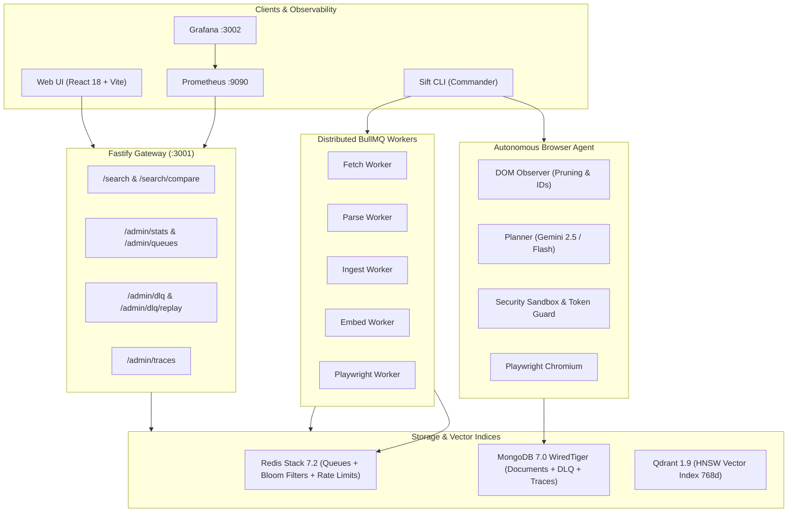
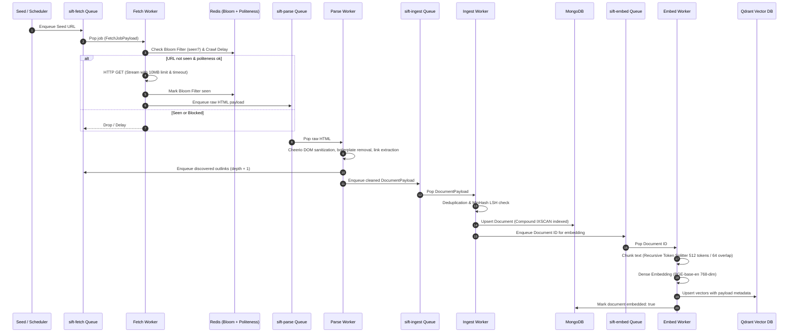
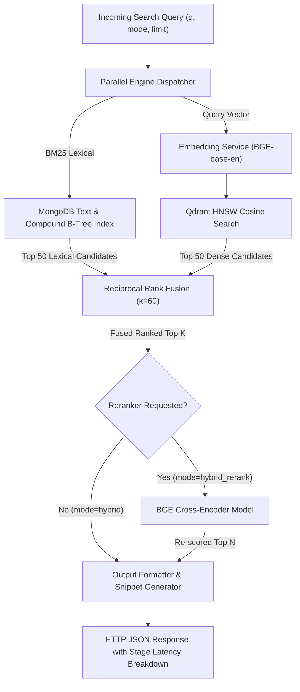
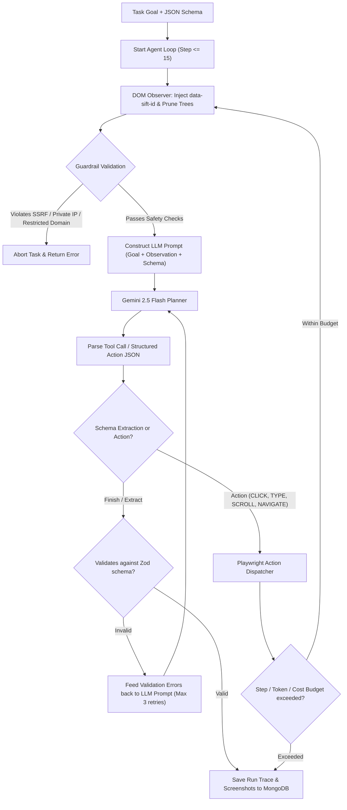

# Sift System Architecture

Sift is a production-grade, distributed web crawler, hybrid search engine, and autonomous browser agent platform engineered for low latency, high throughput, and robust fault tolerance.

---

## 1. High-Level System Topology

---

## 2. Distributed Crawl & Ingestion Pipeline

The crawl pipeline follows a decoupled, asynchronous queue architecture coordinated by BullMQ over Redis:

---

## 3. Hybrid Search & Multi-Stage Retrieval Architecture

Sift's search service executes parallel lexical and semantic retrievals, combines them via Reciprocal Rank Fusion (RRF), and selectively applies Cross-Encoder re-ranking:

---

## 4. Autonomous Browser Agent Architecture

The browser agent operates in a closed observation-action loop equipped with defense-in-depth safety controls:

---

## 5. Fault Tolerance & Dead Letter Queue (DLQ) Architecture

Every job is subject to categorized retry policies and DLQ archiving:

| Error Classification | Max Retries | Backoff Strategy | DLQ Action |
|---|---|---|---|
| `HTTP_STATUS_429` | 5 | Exponential with Jitter | Move to DLQ with Retry-After timestamp |
| `HTTP_STATUS_5XX` | 3 | Exponential backoff (1s, 2s, 4s) | Move to DLQ after attempt 3 |
| `TIMEOUT` | 3 | Linear backoff | Move to DLQ |
| `PARSER_FAILURE` | 1 | None | Immediately moved to DLQ |
| `DNS_NXDOMAIN` | 0 | None (unrecoverable) | Dropped / Logged |
| `SSRF_ATTEMPT` | 0 | None (security violation) | Blocked immediately and reported |

Operators can inspect error stacks, filter by classification, and replay failed jobs with one click via `POST /admin/dlq/replay` or the Web UI.
